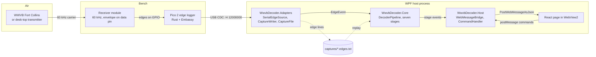
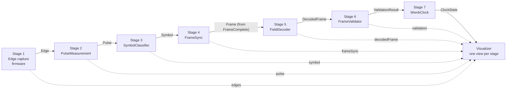
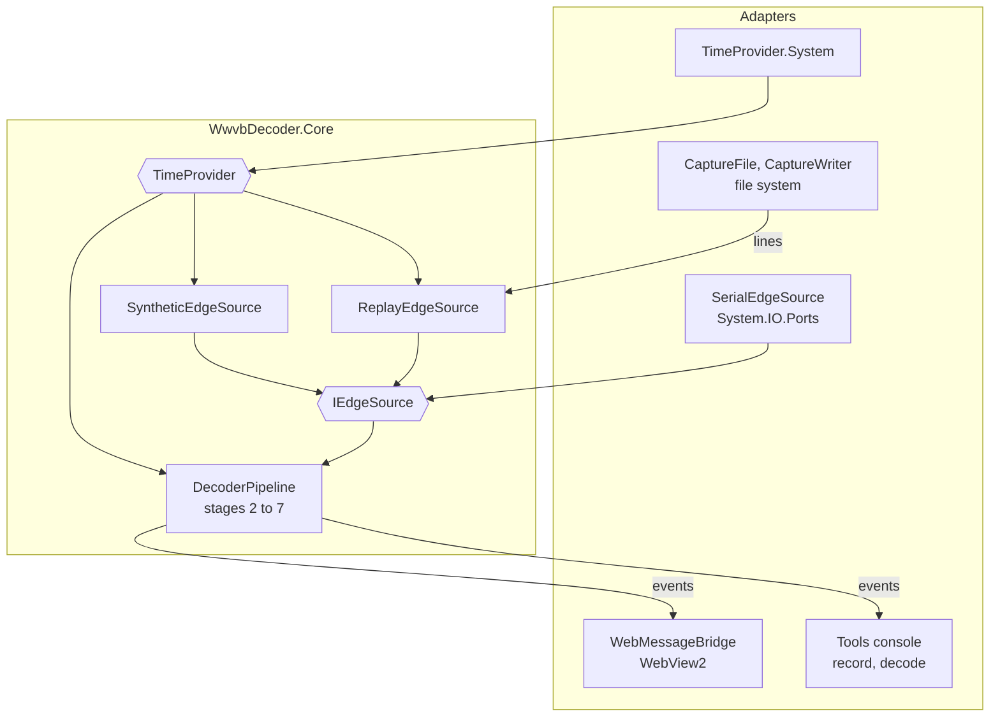
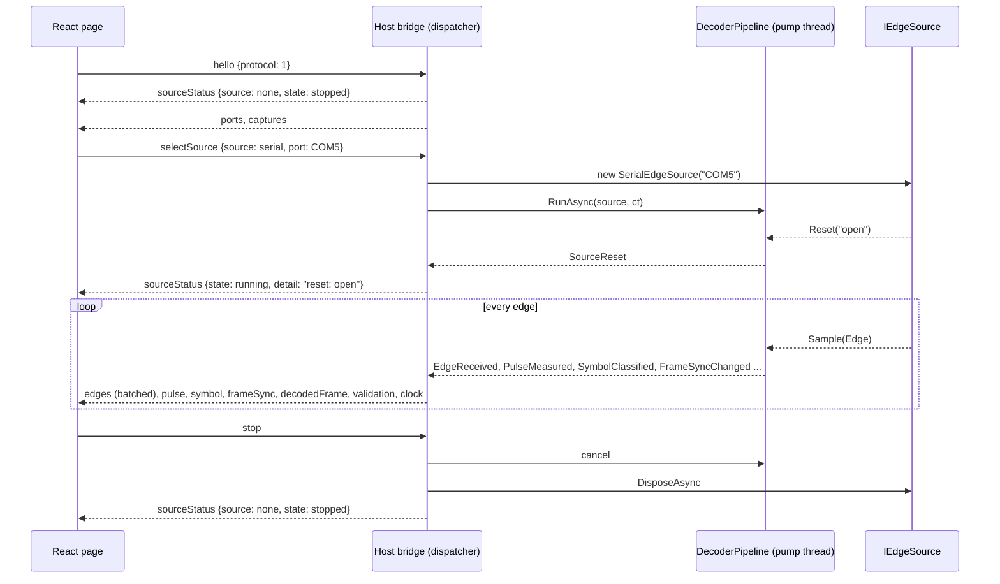

# Architecture

Four views of the decoder, from the antenna to the screen. The decisions behind them are ADR-0001 to ADR-0006; the types on the arrows are defined in [`pipeline-contracts.md`](pipeline-contracts.md) and their JSON forms in [`webview2-messages.md`](webview2-messages.md).

## Components

WWVB's 60 kHz carrier, or the desk-top transmitter from construction plan Step 14, reaches a receiver module whose data pin follows the carrier envelope. A Pico 2 timestamps every edge on that pin and writes one text line per edge over USB serial (ADR-0001, ADR-0002). On the laptop, one WPF process holds everything else (ADR-0003): the Adapters library owns the serial port and the capture files, the Core library runs the seven-stage pipeline, and the Host's bridge turns stage events into web messages for the React page in WebView2.

## Pipeline data flow

Each stage is a class with one typed input and one typed output (ADR-0005). The pipeline pushes every edge depth-first through stages 2 to 7 and raises one event per stage output, so the visualizer can draw every stage as it happens: the raw edges, the measured pulses, the classified symbols, the frame filling up, the decoded fields, the verdict, and the clock. Only `FrameComplete` events carry on past stage 4; `Searching`, `SlotFilled`, and `SyncLost` reach the page but not stage 5.

## Hexagonal view

Core is pure computation: domain records, the six host stages, the pipeline, the line codec, and the two sources that need no I/O, synthetic and replay over in-memory lines. It reaches the outside world only through two ports, `IEdgeSource` for edges and .NET's `TimeProvider` for PC time (ADR-0004). Everything that touches a device, a file, a window, or a console is an adapter around it, so the whole pipeline is tested with a fake clock and scripted edges, and the demo can switch between live RF, a recording, and a generator without Core noticing.

## A session

The page loads, subscribes to `window.chrome.webview`, and says `hello`. The host answers with its current state so a reloaded page recovers. The user picks a source; the host stops any run in progress, builds the source, and starts the pipeline on a thread-pool thread. Stage events arrive on that pump thread, are serialized there, and are posted from the WPF dispatcher; edges are batched, everything else is one message each. `stop` cancels the run and disposes the source.

