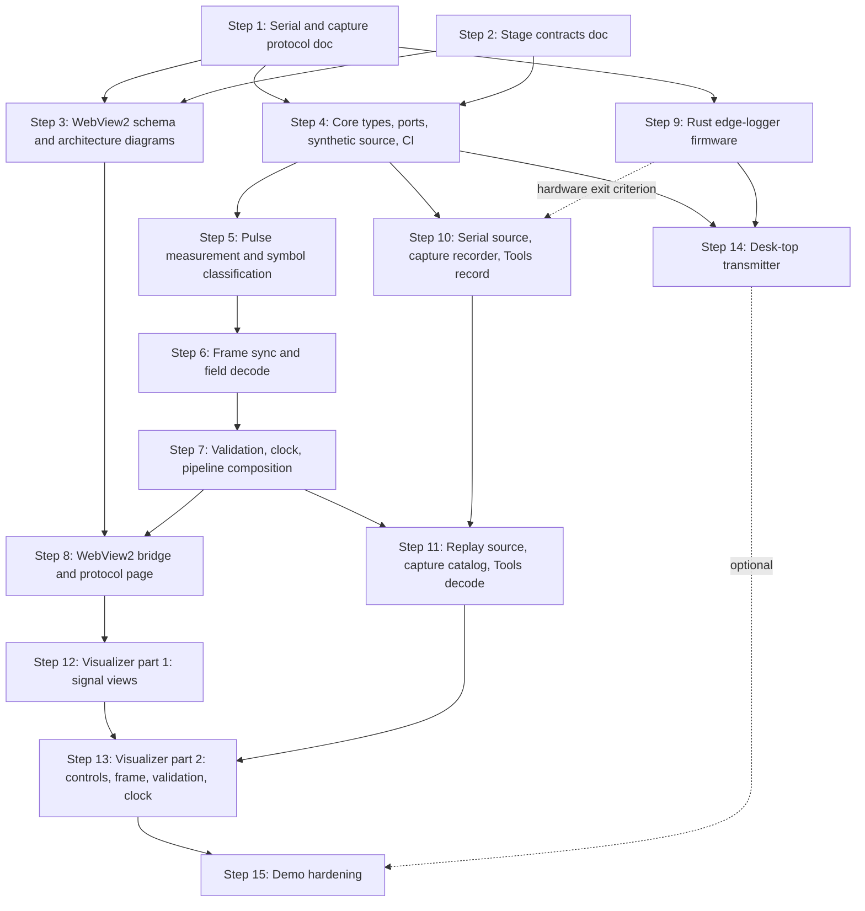

# WWVB Decoder Construction Plan

**Objective**: Design and build the WWVB decoder described in the (local-only) `notes/plan.md`: a Pico 2 that timestamps receiver edges, a C# pipeline of seven typed stages, and a React visualizer in WebView2, with replay and synthetic sources so the Dec 10, 2026 talk never depends on live RF.

**Generated**: 2026-10-31. Reviewed the same day by an independent agent against a cold-start, dependency, technical-accuracy, and ADR-conformance checklist; all critical and major findings are folded in.
**Mode**: git + GitHub CLI available (`origin` = `github.com/byte2pixel/wwvb-decoder`, private, default branch `main`). Every step is one branch and one PR. Solo project: self-merge after the step's verification passes.
**Talk**: Thursday, Dec 10, 2026. Hard deadline. Cut order if behind: Step 14 entirely; then the stage 4 to 7 views in Step 13 reduced to text tables (the source controls in Step 13 are never cut); then the histogram in Step 12. Never cut Steps 10 or 11: replay is what makes the demo independent of RF.

## How to use this plan

Each step below is self-contained. A fresh agent can pick up any step by reading only this document's **Fixed design decisions** section, the step itself, and the files the step's context brief names. Do not read earlier steps to execute a later one.

Conventions for every step:

1. Start from `main`: `git checkout main && git pull && git checkout -b step-NN-<slug>`.
2. Do the tasks. Keep the diff inside the step's **Files** list; anything else is a plan mutation (see the protocol at the end).
3. Run the step's **Verification** commands and the **Invariants** at the end of this document. All must pass.
4. Commit with a message starting `Step NN:`. Push and open a PR with `gh pr create --fill`. Merge with `gh pr merge --squash --delete-branch` once CI (added in Step 4) is green.
5. Tick the step off in the **Audit trail** at the bottom of this file in the same PR.

Toolchain verified on the development machine on 2026-10-31:

| Tool | Version |
| --- | --- |
| .NET SDK | 10.0.403 |
| Node.js / npm | 24.13.0 / 11.6.2 |
| cargo | 1.99.1 |
| picotool | 2.3.1 |

## Fixed design decisions

These are already decided and recorded. Steps implement them; they do not reopen them.

**From the ADRs in `docs/design/adr/`** (read them before any step):

- ADR-0001: firmware only timestamps edges and reports the raw pin level; polarity is interpreted on the host (amended 2026-10-31).
- ADR-0002: Rust + Embassy firmware, C fallback.
- ADR-0003: one .NET 10 WPF host, React in WebView2, web messages.
- ADR-0004: `IEdgeSource` with serial, replay, and synthetic implementations.
- ADR-0005: seven stages, each a class with a typed input and output.
- ADR-0006: validation by markers, unused bits, ranges, and frame-to-frame consistency.

**Decided in this plan** (Steps 1 to 3 write these up in detail; later steps follow them):

- **Hexagonal layout of the host solution.** `WwvbDecoder.Core` holds the domain types, the ports, the six host-side stages, the pipeline composition, the serial/capture line codec, `SyntheticEdgeSource`, and `ReplayEdgeSource` over in-memory lines. It has no reference to WPF, WebView2, `System.IO.Ports`, or the file system. A new `WwvbDecoder.Adapters` class library holds `SerialEdgeSource`, file-backed capture reading and writing, and serial port enumeration. `WwvbDecoder.Host` (WPF) is the composition root plus the WebView2 bridge. A new `WwvbDecoder.Tools` console app records captures and replays them to stdout for development before the visualizer exists.
- **Shared build settings.** `host/Directory.Build.props` sets nullable, implicit usings, and `TreatWarningsAsErrors` for every project in every configuration, so a build that is clean locally is clean in CI. `host/src/Directory.Build.props` adds `GenerateDocumentationFile`, so every public member in production code needs an XML doc comment. `host/tests/Directory.Build.props` adds the xunit stack (`xunit.v3`, with `OutputType` `Exe` because a v3 test project is executable), Shouldly for assertions, and global usings for `Xunit` and `Shouldly` to every test project. Tests use v3 for `TestContext.Current.CancellationToken`, which the endless synthetic stream needs. A root `global.json` selects `Microsoft.Testing.Platform` as the test runner, because `dotnet test` on the .NET 10 SDK refuses to run this package through VSTest. Both nested files import the root one. Package versions live only in `host/Directory.Packages.props` (central package management); a csproj names a package without a version. `host/Directory.Build.props` and `host/src/Directory.Build.props` never hold a `PackageReference`: a production package goes in the csproj that needs it, where the hexagonal rule can see it.
- **Stage shape.** Every host stage implements `IStage<TIn, TOut>` with `IEnumerable<TOut> Push(TIn input)` and `void Reset()`. Stages are synchronous and single-threaded; zero or more outputs per input. The pipeline pumps one `Task` from the source through the stages in order and raises a per-stage `event Action<T>` on that pump thread. Subscribers (the bridge) marshal to their own thread. Options that the UI changes while running (`Noise`, `Speed`, `ReducedCarrierLevel`) are written from the dispatcher thread and read on the pump thread; they are `volatile` fields or use `Volatile.Read`/`Volatile.Write`.
- **Source events.** `IEdgeSource.ReadAsync` yields `EdgeEvent`, a sealed record hierarchy with three cases: `EdgeEvent.Sample(Edge Edge)`, `EdgeEvent.Reset(string Reason)`, `EdgeEvent.Info(string Line)`. The case is named `Sample`, not `Edge`, to avoid colliding with the `Edge` struct.
- **Time.** All stage logic uses edge timestamps in microseconds (`ulong`) from the Pico. PC time enters only through .NET's `TimeProvider`, injected into the clock stage and the paced sources. Pacing uses `Task.Delay(TimeSpan, TimeProvider, CancellationToken)`, so tests drive it with `FakeTimeProvider` (package `Microsoft.Extensions.TimeProvider.Testing`, namespace `Microsoft.Extensions.Time.Testing`) by calling `Advance`.
- **Polarity.** The firmware reports the raw pin level after each edge. Which level means "reduced carrier" is a setting on the pulse-measurement stage (`ReducedCarrierLevel`), switchable from the UI. A single pulse cannot reveal polarity (0.2 vs 0.8 s is symmetric); an inverted setting turns most zeros into 0.8 s "markers", so frame sync never finds the double marker. Step 15 adds a warning heuristic for that. Measured 2026-11-02 on receiver #1: T idles low and is high during the reduced-carrier pulse, so the default is `High`.
- **Glitch handling (stage 2).** Two rules, both with the same `MinPulseMicros` threshold (default 50 ms): a reduced-carrier pulse shorter than the threshold is dropped; a full-carrier gap shorter than the threshold between two reduced-carrier pulses is bridged, merging them into one pulse. To bridge, the stage holds a finished pulse until the next entering edge confirms the gap is long enough (or `Reset()` flushes it), so stage 2 output lags by up to one second.
- **Serial line protocol** (Step 1 specifies fully): ASCII, LF-terminated, one edge per line `<L|H> <micros>` where the letter is the pin level after the edge and micros is an unsigned decimal `u64` from the Pico's boot. Lines starting with `#` are informational (`# session`, `# wwvb-edge-logger <version> pin=<n>`). The host ignores lines it does not understand. The codec maps `# session` to `EdgeEvent.Reset("session")`, other `#` lines to `Info`, and edge lines to `Sample`. Sources add a `Reset("timestamp went backwards")` when a timestamp is smaller than the previous one. Ports are chosen by name in the UI; the host confirms it is talking to the logger by the banner line, not by USB IDs.
- **Capture file format** (Step 1): a text file with the same edge lines, preceded by `#` header lines (`# capture v1`, `# recorded <ISO-8601 UTC>`, `# source <description>`), and a `# wall <ISO-8601 UTC> <micros>` line once per minute so replay can show the recorded PC-clock offset. Extension `.edges.txt`, stored under `captures/`.
- **WebView2 message protocol** (Step 3): host to page is a JSON envelope `{ "type": string, "seq": number, "payload": object }` with one `type` per stage output plus status types; edges are batched. Page to host is `{ "command": string, ...args }`, including `hello`. `System.Text.Json` with camelCase on both sides. Example JSON per message type lives in `docs/design/message-examples/` and both test suites assert against those files.
- **Frame encoding convention.** The frame transmitted during a minute encodes the UTC time at that frame's second 0 (the minute in progress). Confirmed against the WWVB time-code description ("the time code is always transmitted in the minute immediately after the moment it represents"; the on-time point is the leading edge of the second-0 marker). Step 2 cites the NIST source in the contracts document.
- **PC-clock offset.** Because a frame completes about 59.8 s after the instant it encodes, `OffsetFromPc` is `(FrameUtc + (Frame.EndMicros - Frame.StartMicros)) - TimeProvider.GetUtcNow()` taken when the frame completes, where `EndMicros` is the end of the second-59 symbol.

## Dependency graph



Parallel groups:

| Group | Steps | Notes |
| --- | --- | --- |
| A | 1, 2 | Different documents |
| B | 5, 6, 7 and 9 | C# stages vs Rust firmware |
| C | 8 and 10, then 8 and 11 | Host bridge vs Adapters/Tools. Both 8 and 10 add projects to `host/WwvbDecoder.slnx` and jobs to `.github/workflows/ci.yml`; expect a trivial merge conflict in those two files and resolve by keeping both additions |
| D | 12, 14 | React vs Rust |

## Schedule

Mapped onto the milestone table from the plan, adjusted for actual deliveries (updated Sat Oct 31):

| Arrives | Parts |
| --- | --- |
| Sat Oct 31 | Pico 2 #1 (headers pre-soldered), USB logic analyzer, 22 AWG wire |
| Sun Nov 1 | Receiver #1, breadboard and jumper kit, breakaway headers, USB hub, 5 m active extension |
| Wed Nov 4 | Pico 2 #2 (was expected Oct 31 but has not shipped), receiver #2, resistor kit |

Because the first Pico arrived three days early, Step 9 starts immediately and its hardware bring-up needs only a jumper to ground. Raw overnight captures can start as soon as Step 9 streams lines, before Step 10 exists: log the serial port to a file with any terminal program and add the Step 1 header by hand (Step 9, Task 7). The receiver's levels were read in PulseView on the night of Nov 1 (idle low, reduced carrier high), settling the polarity note in Step 1 before any firmware ran. The same session showed the scaffold blinky's 1 Hz LED load modulating the receiver output through the Pico's supply, which is why Step 9 forces the regulator into PWM mode and keeps the LED steady. Soldering the 4-pin receiver headers needs the header strips (Sunday) and an iron; until then, header pins pushed into the module's holes and held by the breadboard are enough for a bench test.

This schedule is tight for evenings and weekends; the cut order in the header applies.

| Step | Window | Milestone |
| --- | --- | --- |
| 1, 2 | Nov 1 | Documentation first |
| 9 | Oct 31 to Nov 4 | Rust edge logger; bench test with a jumper Oct 31, with receiver #1 Nov 1 |
| 4 | Nov 2 to Nov 3 | C# pipeline against synthetic data |
| 3 | Nov 3 to Nov 5 | Documentation (gates only Step 8) |
| 5, 6, 7 | Nov 3 to Nov 10 | C# pipeline against synthetic data |
| 10 | Nov 3 to Nov 6 | Recorder; first terminal-logged overnight capture by Nov 2, recorder-made capture by Nov 6 |
| 11 | Nov 10 to Nov 13 | Replay |
| 8 | Nov 11 to Nov 16 | WebView2 shell |
| 12, 13 | Nov 16 to Nov 30 | React visualizer |
| 14 | Nov 23 to Dec 1 | Desk-top transmitter (Thanksgiving Nov 26) |
| 15 | Dec 1 to Dec 4 | Window test and dry run |
| On-site | Dec 7 to Dec 11 | Test in the actual room; talk Thu Dec 10 |

---

## Step 1: Serial line protocol and capture file format

**Depends on**: nothing
**Parallel with**: Step 2
**Model tier**: strongest
**Window**: Nov 1

### Context brief

The Pico 2 firmware (ADR-0001, ADR-0002) will send one line per GPIO edge over USB CDC serial. The host parses those lines into `Edge` values; the same lines, with a header, become capture files for replay (ADR-0004). This step writes the specification both sides implement. Read `docs/design/adr/0001-firmware-only-timestamps-edges.md` and `docs/design/adr/0004-iedgesource-serial-replay-synthetic.md`. The existing `firmware/README.md` has the wiring table (receiver T pin on GP2).

Embassy's `Instant::now().as_micros()` is a `u64`, so wraparound is not a practical concern, but the host must tolerate a timestamp going backwards (Pico reset) by treating it as a source reset.

### Tasks

1. Write `docs/design/serial-protocol.md` with exactly these level-2 headings, in this order: `## Transport`, `## Encoding`, `## Edge lines`, `## Informational lines`, `## Reset detection`, `## Error handling`, `## Rate and back-pressure`, `## Example`. Content:
   - Transport: USB CDC ACM, any baud (ignored by CDC), 8N1, no flow control, DTR asserted by the host. USB VID/PID: `embassy-usb` has no defaults; this project uses the Embassy example values 0xC0DE / 0xCAFE (acceptable for a private device), manufacturer `wwvb-decoder`, product `wwvb-edge-logger`. The host does not identify the device by USB IDs; the user picks the port by name and the host confirms by the banner line.
   - Encoding: ASCII, lines end in `\n`, maximum line length 64 bytes.
   - Edge lines: `<level> <micros>\n`, where `level` is `H` or `L` (pin level after the edge) and `micros` is an unsigned decimal integer, microseconds since firmware boot. Equal consecutive timestamps are legal (bounce); decreasing ones mean a reset.
   - Informational lines: `# session` (first line of every session, each time the host asserts DTR), `# wwvb-edge-logger <semver> pin=<gpio>` (banner), `# dropped <n>` (edges lost to a full buffer since the last report), and the rule that hosts ignore any `#` line they do not know. State the codec mapping: `# session` becomes a reset event, other `#` lines become info events.
   - Reset detection: `# session` or a timestamp smaller than the previous one means a new session or a Pico restart; the host emits a source reset and stages call `Reset()`.
   - Error handling: a malformed line is counted and skipped, never fatal.
   - Rate and back-pressure: about two edges per second from the receiver; worst case during noise, bursts of a few hundred per second. Firmware must never block on USB; if its queue is full, drop the edge and count it.
   - Example: ten lines showing a "0" second and a marker second, with the reduced-carrier level written as `L` and a note that Step 9 confirms or corrects this on hardware. If the logic analyzer has already shown the receiver's levels (receiver #1 arrives Nov 1), write the observed level instead and say so.
2. Write `docs/design/capture-format.md` with exactly these level-2 headings: `## File name`, `## Header`, `## Body`, `## Wall-clock lines`, `## Replay semantics`, `## Example`. Content:
   - File name `captures/<YYYY-MM-DD>T<HHMM>Z-<label>.edges.txt`. UTF-8, LF.
   - Header: `# capture v1`, `# recorded <ISO-8601 UTC>`, `# source <free text, e.g. serial COM5 WVB-0860N-03A receiver #1 at west window>`, `# reduced-carrier-level <H|L>` if known.
   - Body: edge lines exactly as received from serial, including any `#` lines from the firmware.
   - Wall-clock lines: `# wall <ISO-8601 UTC> <micros>` emitted by the recorder once per minute, pairing the PC clock with a Pico timestamp.
   - Replay semantics: timestamps are relative; replay pacing uses deltas between consecutive edges; `# session` resets the pacing baseline; files are small enough (a night is a few megabytes) to load fully into memory.
   - Example: a header plus ten body lines.
3. Add both documents to the table in `docs/design/README.md`.

### Files

- `docs/design/serial-protocol.md` (new)
- `docs/design/capture-format.md` (new)
- `docs/design/README.md` (table rows)

### Verification

```powershell
(Select-String -Path docs/design/serial-protocol.md -Pattern '^## (Transport|Encoding|Edge lines|Informational lines|Reset detection|Error handling|Rate and back-pressure|Example)$' | Measure-Object).Count   # expect 8
(Select-String -Path docs/design/capture-format.md -Pattern '^## (File name|Header|Body|Wall-clock lines|Replay semantics|Example)$' | Measure-Object).Count   # expect 6
git ls-files --eol docs/design/serial-protocol.md docs/design/capture-format.md   # must show i/lf w/lf
```

### Exit criteria

- A developer who has never seen the firmware could write a parser from `serial-protocol.md` alone.
- A developer could hand-write a valid capture file from `capture-format.md` alone.
- Both documents are linked from `docs/design/README.md`.

### Rollback

Revert the PR. No code depends on these files until Step 4.

---

## Step 2: Stage contracts (IEdgeSource, IStage, seven stage types)

**Depends on**: nothing
**Parallel with**: Step 1
**Model tier**: strongest
**Window**: Nov 1

### Context brief

ADR-0005 fixes seven stages; ADR-0004 fixes `IEdgeSource` and its three implementations; ADR-0006 fixes the validation checks. This step turns those into concrete C# contracts, written as a design document with code blocks, that Steps 4 to 7, 10, and 11 implement verbatim. Read all six ADRs and the **Fixed design decisions** section above, especially the stage shape, source events, glitch handling, polarity, and PC-clock offset decisions.

The WWVB frame layout (one bit per second, frame encodes UTC at second 0):

| Seconds | Field | Bit weights |
| --- | --- | --- |
| 0, 9, 19, 29, 39, 49, 59 | Markers | 0.8 s pulses |
| 1 to 3, 5 to 8 | Minute | 40 20 10 . 8 4 2 1 |
| 12 to 13, 15 to 18 | Hour | 20 10 . 8 4 2 1 |
| 22 to 23, 25 to 28, 30 to 33 | Day of year | 200 100 . 80 40 20 10 . 8 4 2 1 |
| 36 to 38 | UT1 sign | 1-0-1 = +, 0-1-0 = - |
| 40 to 43 | UT1 correction | 0.8 0.4 0.2 0.1 s |
| 45 to 48, 50 to 53 | Year (2 digits) | 80 40 20 10 . 8 4 2 1 |
| 55 / 56 / 57 to 58 | Flags | Leap year / leap second pending / DST status (00 standard, 11 DST, 10 DST begins today, 01 DST ends today) |
| 4, 10, 11, 14, 20, 21, 24, 34, 35, 44, 54 | Unused | Always 0 |

Pulse semantics: reduced carrier starts at the top of each second and lasts 0.2 s for 0, 0.5 s for 1, 0.8 s for a marker. Classification thresholds: below 0.35 s is 0, 0.35 to 0.65 s is 1, above 0.65 s is marker, outside 0.1 to 0.9 s is error.

### Tasks

1. Cite the NIST WWVB time-code description (and the WWVB Wikipedia article as a secondary source) for the frame layout and the "minute in progress" convention at the top of the document.
2. Write `docs/design/pipeline-contracts.md` with these C# contracts, namespace `WwvbDecoder.Core`:
   - `public enum PinLevel { Low, High }`
   - `public readonly record struct Edge(ulong Micros, PinLevel Level);`
   - `public abstract record EdgeEvent` with sealed nested cases `Sample(Edge Edge)`, `Reset(string Reason)`, `Info(string Line)`.
   - `public interface IEdgeSource : IAsyncDisposable { string Name { get; } IAsyncEnumerable<EdgeEvent> ReadAsync(CancellationToken ct); }`
   - `public interface IStage<in TIn, out TOut> { IEnumerable<TOut> Push(TIn input); void Reset(); }`
   - Stage 2 `PulseMeasurement : IStage<Edge, Pulse>` with options `ReducedCarrierLevel` (default `High`, volatile) and `MinPulseMicros` (default 50_000). Output `public readonly record struct Pulse(ulong StartMicros, ulong DurationMicros);`. Counters `long GlitchesDropped`, `long GapsBridged`, `long UnpairedEdges`. Behavior: an edge into the reduced-carrier level starts a pulse; the edge out of it finishes the pulse, which is held pending; the next entering edge either bridges (gap shorter than `MinPulseMicros`: extend the pending pulse and keep it pending) or confirms (emit the pending pulse if its duration is at least `MinPulseMicros`, else drop and count). Two consecutive edges with the same level count as unpaired and resynchronize on the next edge of the expected level. A timestamp strictly smaller than the previous one throws `InvalidOperationException` (the pipeline resets stages on a source reset before that can happen); equal timestamps are allowed. `Reset()` discards the pending pulse.
   - Stage 3 `SymbolClassifier : IStage<Pulse, Symbol>` with thresholds as options: `ZeroOneThresholdMicros` (350_000), `OneMarkerThresholdMicros` (650_000), `MinValidMicros` (100_000), `MaxValidMicros` (900_000). Output `public readonly record struct Symbol(ulong StartMicros, ulong DurationMicros, SymbolKind Kind);` and `public enum SymbolKind { Zero, One, Marker, Error }`.
   - Stage 4 `FrameSync : IStage<Symbol, FrameSyncEvent>`. Output is a sealed record hierarchy: `FrameSyncEvent.Searching(int ConsecutiveMarkers)`, `FrameSyncEvent.SlotFilled(ulong FrameStartMicros, int Second, SymbolKind Kind)`, `FrameSyncEvent.FrameComplete(Frame Frame)`, `FrameSyncEvent.SyncLost(string Reason)`. `public sealed record Frame(ulong StartMicros, ulong EndMicros, ImmutableArray<SymbolKind> Symbols)` with exactly 60 entries; `EndMicros` is the end of the second-59 symbol. Sync rule: two consecutive markers mean the second one is second 0. While synced, a marker where a bit is expected or a bit where a marker is expected ends the frame with `SyncLost`; an `Error` symbol is placed as-is (field decode and validation deal with it). A gap between consecutive symbol starts outside 0.5 to 1.5 s also loses sync.
   - Stage 5 `FieldDecoder : IStage<Frame, DecodedFrame>`. Pure BCD read without range checks. `public sealed record DecodedFrame(Frame Frame, int Minute, int Hour, int DayOfYear, int Year, Ut1Sign Ut1Sign, int Ut1Tenths, bool LeapYear, bool LeapSecondPending, DstStatus Dst, ImmutableArray<int> ErrorSeconds)`. A field containing an `Error` symbol decodes with that bit as 0 and the second listed in `ErrorSeconds`. `Ut1Sign { Plus, Minus, Invalid }`, `DstStatus { Standard, Dst, BeginsToday, EndsToday }`.
   - Stage 6 `FrameValidator : IStage<DecodedFrame, ValidationResult>`. `public sealed record ValidationResult(DecodedFrame Frame, bool Accepted, ImmutableArray<ValidationFailure> Failures)`, `public sealed record ValidationFailure(ValidationCheck Check, string Detail)`, `public enum ValidationCheck { Markers, UnusedBits, ErrorSymbols, BcdDigits, MinuteRange, HourRange, DayOfYearRange, Ut1Sign, Ut1Range, Consecutive }`. Checks run in that order and all failures are reported; the first is the headline. `BcdDigits` re-derives every BCD digit (minute tens and units, hour tens and units, day hundreds, tens, units, year tens and units) from the frame via `WwvbFrameLayout` and fails if any digit exceeds 9. `Consecutive` compares against the last accepted frame using real date arithmetic (`DateTime` from the decoded fields, year 2000 + two digits) and requires exactly one minute apart with `StartMicros` difference within 60 s plus or minus 50 ms. It is skipped (not failed) when there is no previous accepted frame or the previous accepted frame's `StartMicros` is more than 90 s behind. Leap second: when the previous accepted frame had `LeapSecondPending` and this frame is the first minute of a UTC month, accept a `StartMicros` difference of 61 s. State: last accepted `DecodedFrame`.
   - Stage 7 `WwvbClock : IStage<ValidationResult, ClockState>` with `TimeProvider` injected. `public sealed record ClockState(ClockStatus Status, DateTimeOffset? FrameUtc, ulong? FrameStartMicros, ulong? FrameEndMicros, TimeSpan? OffsetFromPc, int ConsecutiveAccepted, int RejectedSinceLastAccepted)`, `public enum ClockStatus { NoSignal, Acquiring, Locked, Holding }`. `Acquiring` on the first frame of any kind, `Locked` at two consecutive accepted, `Holding` on a rejection while locked, back to `Acquiring` after three rejections in a row. `FrameUtc` is built from the decoded fields (day of year to month and day; year 2000 + two digits); local time is derived in the UI from `Dst`. `OffsetFromPc` per the fixed decision: `(FrameUtc + (EndMicros - StartMicros)) - TimeProvider.GetUtcNow()` at `Push` time.
   - `DecoderPipeline`: owns one of each host stage, `Task RunAsync(IEdgeSource source, CancellationToken ct)`, and events `EdgeReceived`, `PulseMeasured`, `SymbolClassified`, `FrameSyncChanged`, `FrameDecoded`, `FrameValidated`, `ClockUpdated`, `SourceReset`, `InfoReceived`. Events fire on the pump thread. `Reset` events from the source call `Reset()` on every stage. A stage exception stops the run and surfaces through the returned `Task`.
   - `WwvbFrameLayout`: a static table of the frame layout above (fields with their seconds and weights, marker seconds, unused seconds, flag seconds), used by `FieldDecoder`, `FrameValidator`, and `WwvbFrameEncoder`, so the layout exists in exactly one place in C#.
   - `WwvbFrameEncoder`: `Frame Encode(DateTimeOffset utcMinute, ulong startMicros, Ut1Sign sign, int ut1Tenths, bool leapSecondPending, DstStatus dst)` producing the 60 symbols for the minute in progress; `EndMicros = startMicros + 59_800_000` by convention (end of the 0.8 s marker at second 59). Leap-year flag derived from the year.
   - `EdgeLineCodec`: `bool TryParse(ReadOnlySpan<char> line, out EdgeEvent evt)` and `string Format(Edge edge)` implementing `serial-protocol.md`; `# session` yields `Reset("session")`, other `#` lines `Info`, edge lines `Sample`; malformed lines return false.
   - `SyntheticEdgeSource : IEdgeSource` options: `StartUtc`, `Speed` (0 = unpaced, 1 = real time, N = N times faster), `Noise` in [0, 1] (volatile, settable while running), `ReducedCarrierLevel`, `Seed`. Noise model per second, with probability `Noise`: one of (a) duration jitter of plus or minus up to 0.3 s, (b) a full-carrier glitch of 10 to 40 ms inserted inside the reduced-carrier pulse (which stage 2 bridges), (c) a reduced-carrier glitch of 10 to 40 ms inserted in the full-carrier part (which stage 2 drops), or (d) one edge dropped (which stage 2 counts as unpaired). The source emits `Reset("start")` first and then, per second, the entering edge at the second boundary and the leaving edge after the symbol's duration.
   - `ReplayEdgeSource : IEdgeSource` (Core) constructed from `IReadOnlyList<string> lines`, `TimeProvider`, options `Speed` (volatile) and `Loop`. Exposes `CaptureInfo Info` parsed from the header: `Recorded`, `Source`, `ReducedCarrierLevel?`, and `WallSamples` (list of UTC plus micros pairs). Emits `Reset("start")` first; `# session` resets the pacing baseline; `# wall` lines are forwarded as `Info`; with `Loop`, end of data emits `Reset("loop")` and starts over.
3. Include three worked examples in the document: a clean "0" second through stages 2 and 3 including the pending-pulse hold; a frame start (marker, marker) through stage 4; a full frame with one flipped bit through stages 5 and 6 showing the `Consecutive` failure.
4. Add the document to `docs/design/README.md`.

### Files

- `docs/design/pipeline-contracts.md` (new)
- `docs/design/README.md` (table row)

### Verification

```powershell
(Select-String -Path docs/design/pipeline-contracts.md -Pattern 'IEdgeSource|IStage<|PulseMeasurement|SymbolClassifier|FrameSync\b|FieldDecoder|FrameValidator|WwvbClock|DecoderPipeline|WwvbFrameLayout|WwvbFrameEncoder|EdgeLineCodec|SyntheticEdgeSource|ReplayEdgeSource|CaptureInfo' | Measure-Object).Count   # expect >= 15
Select-String -Path docs/design/pipeline-contracts.md -Pattern 'EdgeEvent\.Edge\('   # expect no output (the case is named Sample)
git ls-files --eol docs/design/pipeline-contracts.md
```

### Exit criteria

- Every type Steps 4 to 7, 10, and 11 create is named and shaped in this document, including options and defaults.
- The frame layout table appears once, with the sources it was checked against.
- The three worked examples are consistent with the thresholds and rules stated.

### Rollback

Revert the PR.

---

## Step 3: WebView2 message schema and architecture diagrams

**Depends on**: Steps 1, 2
**Parallel with**: Steps 4, 5
**Model tier**: strongest
**Window**: Nov 3 to Nov 5

### Context brief

ADR-0003 fixes the bridge: C# calls `CoreWebView2.PostWebMessageAsJson`; the page listens for `message` on `window.chrome.webview` and replies with `postMessage`. One message type per stage output. This step writes the JSON schema document, the example files both test suites will assert against, and the architecture diagrams. Read `docs/design/pipeline-contracts.md` (Step 2) for the output types and `docs/design/adr/0003-wpf-host-react-webview2.md`. The current `host/src/WwvbDecoder.Host/MainWindow.xaml.cs` already navigates to the dev server or `wwwroot`; the bridge will be added beside it in Step 8.

### Tasks

1. Write `docs/design/webview2-messages.md`:
   - Envelope host to page: `{ "type": "<type>", "seq": <monotonic int>, "payload": <object> }`.
   - Types and payloads, derived mechanically from the Step 2 records with camelCase, enums as camelCase strings: `edges` (payload `{ "items": Edge[] }`, batched and flushed every 100 ms or 200 items, whichever first), `pulse`, `symbol`, `frameSync` (payload carries `"kind": "searching" | "slotFilled" | "frameComplete" | "syncLost"` plus the record fields), `decodedFrame`, `validation`, `clock`, `sourceStatus` (`{ "source": "serial" | "replay" | "synthetic" | "none", "name": string, "state": "stopped" | "running" | "error", "detail": string }`), `ports` (`{ "items": string[] }`), `captures` (`{ "items": { "path": string, "recorded": string, "minutes": number }[] }`), `info` (`{ "line": string }`). `ulong` microseconds serialize as JSON numbers; they stay below 2^53 for over 285 years of uptime. Each type gets one fenced JSON example in the document, identical to its example file.
   - Commands page to host: `{ "command": "hello", "protocol": 1 }` (sent on page load; host logs a mismatch), `{ "command": "selectSource", "source": "serial", "port": "COM5" }`, `{ "command": "selectSource", "source": "replay", "path": "...", "speed": 1 }`, `{ "command": "selectSource", "source": "synthetic", "noise": 0.0 }`, `{ "command": "setReplaySpeed", "speed": 10 }`, `{ "command": "setNoise", "noise": 0.2 }`, `{ "command": "setReducedCarrierLevel", "level": "high" }`, `{ "command": "listPorts" }`, `{ "command": "listCaptures" }`, `{ "command": "stop" }`. One fenced example each.
   - Threading: the bridge receives stage events on the pump thread and posts on the WPF dispatcher.
2. Create `docs/design/message-examples/` with one `.json` file per host-to-page type (`<type>.json`) and per command (`command-<command>.json`), each a single valid example matching the document.
3. Write `docs/design/architecture.md` with four Mermaid diagrams, one short paragraph each:
   - Component diagram: transmitter, receiver module, Pico, USB, Adapters, Core pipeline, Host bridge, WebView2 page.
   - Pipeline data-flow diagram: the seven stages with their input and output types on the arrows and the visualizer subscribing to each.
   - Hexagonal view: Core in the middle, ports (`IEdgeSource`, `TimeProvider`), adapters around it (serial, file, synthetic, WebView2 bridge, console).
   - Sequence diagram: page load, `hello`, `selectSource`, stage messages flowing, `stop`.
4. Add both documents to `docs/design/README.md`.

### Files

- `docs/design/webview2-messages.md` (new)
- `docs/design/message-examples/*.json` (new)
- `docs/design/architecture.md` (new)
- `docs/design/README.md` (table rows)

### Verification

```powershell
# Every example parses as JSON
Get-ChildItem docs/design/message-examples/*.json | ForEach-Object { Get-Content $_ -Raw | ConvertFrom-Json | Out-Null; "ok $($_.Name)" }
# Every host->page type in the doc has an example file, and vice versa
$types = Select-String -Path docs/design/webview2-messages.md -Pattern '"type": "(\w+)"' -AllMatches | ForEach-Object { $_.Matches } | ForEach-Object { $_.Groups[1].Value } | Sort-Object -Unique
$types.Count   # expect 11
$types | ForEach-Object { if (-not (Test-Path "docs/design/message-examples/$_.json")) { "MISSING $_" } }
$commands = Select-String -Path docs/design/webview2-messages.md -Pattern '"command": "(\w+)"' -AllMatches | ForEach-Object { $_.Matches } | ForEach-Object { $_.Groups[1].Value } | Sort-Object -Unique
$commands.Count   # expect 8
$commands | ForEach-Object { if (-not (Test-Path "docs/design/message-examples/command-$_.json")) { "MISSING command-$_" } }
(Select-String -Path docs/design/architecture.md -Pattern '^```mermaid' | Measure-Object).Count   # expect 4
```

### Exit criteria

- Every stage output type and every command has a documented shape, a fenced example, and an example file.
- The four diagrams render on GitHub (check the PR's file view).
- A TypeScript developer can write the page's types from `webview2-messages.md` without reading C#.

### Rollback

Revert the PR.

---

## Step 4: Core types, ports, SyntheticEdgeSource, frame encoder, CI

**Depends on**: Steps 1, 2
**Parallel with**: Step 3
**Model tier**: strongest
**Window**: Nov 2 to Nov 3

### Context brief

First code step. `host/src/WwvbDecoder.Core/` is an empty `net10.0` class library with nullable and implicit usings on. `host/tests/WwvbDecoder.Core.Tests/` is an xunit 2.9.3 project referencing it. Each csproj sets these properties and package versions itself; task 2 moves them into shared props files (see "Shared build settings" above). The contracts to implement are in `docs/design/pipeline-contracts.md`; the line grammar is in `docs/design/serial-protocol.md`. Hexagonal rule: Core references no I/O packages. The synthetic source is in Core because it is pure computation. There is no CI yet and no `.github/` directory. The Host csproj runs `npm ci` and `npm run build` whenever `BuildUi` is true, which defaults on in Release; pass `-p:BuildUi=false` on every CI and local build that is not a publish.

Use records and init-only properties (immutability), `ArgumentNullException.ThrowIfNull`, `CancellationToken` on every async method, and no `async void`.

### Tasks

1. In `WwvbDecoder.Core`, create folders `Domain/`, `Ports/`, `Stages/`, `Sources/`, `Protocol/`, `Pipeline/`. Implement from the contracts document: `PinLevel`, `Edge`, `EdgeEvent` (cases `Sample`, `Reset`, `Info`), `Pulse`, `Symbol`, `SymbolKind`, `Frame`, `FrameSyncEvent`, `DecodedFrame`, `Ut1Sign`, `DstStatus`, `ValidationResult`, `ValidationFailure`, `ValidationCheck`, `ClockState`, `ClockStatus`, `WwvbFrameLayout`, `WwvbFrameEncoder` (Domain); `IEdgeSource`, `IStage<TIn,TOut>` (Ports); `EdgeLineCodec` (Protocol). Stage classes and `DecoderPipeline` come in Steps 5 to 7; do not stub them.
2. Shared build settings. Add `host/Directory.Build.props` (`Nullable`, `ImplicitUsings`, `TreatWarningsAsErrors` with no condition, and `ContinuousIntegrationBuild` when `GITHUB_ACTIONS` is `true`), `host/src/Directory.Build.props` (`GenerateDocumentationFile`, plus a comment that it never holds a `PackageReference`), `host/tests/Directory.Build.props` (`OutputType` `Exe`, `IsPackable` false, references to `xunit.v3` and `Shouldly`, and `<Using>` items for `Xunit` and `Shouldly`), `host/Directory.Packages.props` (`ManagePackageVersionsCentrally`, with the versions in a `Production` group and a `Tests` group), and a root `global.json` that sets `test.runner` to `Microsoft.Testing.Platform`. The test project moves from xunit 2.9.3 to `xunit.v3` 4.0.2, and `Microsoft.NET.Test.Sdk`, `xunit.runner.visualstudio`, and `coverlet.collector` go away. Each nested `Directory.Build.props` imports the root one with `GetPathOfFileAbove`. Remove the properties, `Version` attributes, and test package references these files now supply from the three csproj files. Add the package `Microsoft.Extensions.TimeProvider.Testing` to the test project only: its version goes in the `Tests` group and the reference in `WwvbDecoder.Core.Tests.csproj`. Document `MainWindow`'s public constructor so the Host builds with documentation required. `ImmutableArray` comes from the shared framework.
3. Implement `SyntheticEdgeSource : IEdgeSource` (Sources) exactly as the contracts document specifies, pacing with `Task.Delay(TimeSpan, TimeProvider, CancellationToken)` when `Speed > 0`.
4. Tests (`WwvbDecoder.Core.Tests`), one file per type under test:
   - `EdgeLineCodecTests`: parses `H 1234567`, `L 0` as `Sample`; `# session` as `Reset`; `# dropped 3` as `Info`; rejects `X 12`, `H -1`, `H 1.5`, an empty line, and a 100-character line; `Format` round-trips.
   - `WwvbFrameLayoutTests`: markers at the seven positions, unused set equals the eleven listed seconds, every second 0 to 59 is covered exactly once by marker, field, flag, or unused.
   - `WwvbFrameEncoderTests`: known vector. Encode 2026-12-10T19:30:00Z (day of year 344, not a leap year) and assert the minute bits (30 = `0 1 1 . 0 0 0 0` at seconds 1 to 3 and 5 to 8), hour bits (19 = `0 1 . 1 0 0 1`), day bits (344 = `1 1 . 0 1 0 0 . 0 1 0 0` at seconds 22 to 23, 25 to 28, 30 to 33), year bits (26 = `0 0 1 0 . 0 1 1 0`), markers at the seven marker seconds, zeros at the eleven unused seconds, leap-year flag 0, `EndMicros - StartMicros == 59_800_000`. Write the expected 60-entry array out by hand in the test and comment the arithmetic per field.
   - `SyntheticEdgeSourceTests` with `FakeTimeProvider` and `Speed = 0`: produces a `Reset("start")` then exactly 120 edges per minute with `Noise = 0`; reduced-carrier durations are 200, 500, or 800 ms; same seed gives the same stream; `Noise = 1` changes at least one edge per minute. With `Speed = 1`: after reading the first two events (`Reset("start")` and `H 0`), the third (`L 800000`, the end of the lead-in marker) does not arrive until `fake.Advance(800 ms)`, and the fourth (`H 1000000`) follows `fake.Advance(200 ms)`.
5. Add `.github/workflows/ci.yml`: on push and pull request; job `host` on `windows-latest` runs `dotnet build host/WwvbDecoder.slnx -c Release -p:BuildUi=false` and `dotnet test host/WwvbDecoder.slnx -c Release --no-build -p:BuildUi=false`; job `ui` on `ubuntu-latest` runs `npm ci`, `npm run lint`, `npm run build` in `ui/`; job `firmware` on `ubuntu-latest` installs the `thumbv8m.main-none-eabihf` target and runs `cargo build --release` and `cargo clippy --release -- -D warnings` in `firmware/`. Cache NuGet, npm, and cargo.
6. Update `host/README.md` with the Core folder layout and the hexagonal rule.

### Files

- `host/src/WwvbDecoder.Core/**` (new source)
- `host/tests/WwvbDecoder.Core.Tests/**` (new tests, csproj package addition)
- `host/Directory.Build.props`, `host/Directory.Packages.props`, `host/src/Directory.Build.props`, `host/tests/Directory.Build.props`, `global.json` (new)
- `host/src/WwvbDecoder.Host/WwvbDecoder.Host.csproj` (shared properties and the WebView2 version move out), `host/src/WwvbDecoder.Host/MainWindow.xaml.cs` (doc comment)
- `.github/workflows/ci.yml` (new)
- `host/README.md`

### Verification

```powershell
dotnet build host/WwvbDecoder.slnx --no-incremental -p:BuildUi=false
dotnet build host/WwvbDecoder.slnx -c Release -p:BuildUi=false
dotnet test host/WwvbDecoder.slnx -c Release --no-build -p:BuildUi=false
# Hexagonal rule: Core has no I/O package references, and the props files Core inherits add none
Select-String -Path host/src/WwvbDecoder.Core/WwvbDecoder.Core.csproj -Pattern 'System.IO.Ports|WebView2|UseWPF'   # expect no output
Select-String -Path host/Directory.Build.props, host/src/Directory.Build.props -Pattern '<PackageReference'   # expect no output
# CI green on the PR
gh pr checks
```

### Exit criteria

- All Step 4 tests pass; test count is at least 20.
- The solution builds with no warnings in Debug and Release, and a warning fails the build in both.
- `WwvbFrameEncoder` is the only place that writes bits into a frame and `WwvbFrameLayout` the only place the layout is written down.
- CI runs all three jobs on the PR and is green.

### Rollback

Revert the PR. Nothing else references Core yet beyond the empty Host reference.

---

## Step 5: Pulse measurement and symbol classification (stages 2 and 3)

**Depends on**: Step 4
**Parallel with**: Steps 3, 9
**Model tier**: default
**Window**: Nov 3 to Nov 5

### Context brief

Implement the first two host stages exactly as specified in `docs/design/pipeline-contracts.md`. `Edge`, `Pulse`, `Symbol`, `IStage<TIn,TOut>`, and `SyntheticEdgeSource` exist from Step 4 in `host/src/WwvbDecoder.Core/`. Stages are synchronous, hold their own state, and return `IEnumerable<TOut>` from `Push`. Stage 2 both drops short reduced-carrier pulses and bridges short full-carrier gaps, holding each finished pulse until the next entering edge confirms it. Polarity is the `ReducedCarrierLevel` option.

### Tasks

1. `Stages/PulseMeasurement.cs` per the contract, including the pending-pulse hold, `GlitchesDropped`, `GapsBridged`, `UnpairedEdges`, strict-decrease exception, and `Reset()` discarding the pending pulse.
2. `Stages/SymbolClassifier.cs` per the contract.
3. Tests:
   - `PulseMeasurementTests`: a clean 0/1/marker sequence followed by one more entering edge yields three pulses with the right durations; a 20 ms full-carrier glitch inside a 500 ms pulse yields one 500 ms pulse and `GapsBridged == 1`; a 20 ms reduced-carrier glitch during full carrier is dropped and `GlitchesDropped == 1`; a missing leaving edge is counted as unpaired and the next full pulse is still measured; `ReducedCarrierLevel = Low` inverts correctly; equal timestamps do not throw; a decreasing timestamp throws; `Reset()` clears pending state.
   - `SymbolClassifierTests`: boundary values 349_999 / 350_000 / 649_999 / 650_000; below 100 ms and above 900 ms are `Error`.
   - `SyntheticThroughStage3Tests`: run `SyntheticEdgeSource` (`Speed = 0`, `Noise = 0`, fixed seed) for two minutes through both stages and assert 119 symbols (the last pulse stays pending), markers at the expected positions relative to the frame start, and no `Error` symbols; with `Noise = 0.3` assert at least one of `Error` symbols, `GlitchesDropped`, `GapsBridged`, or `UnpairedEdges` is non-zero and nothing throws.

### Files

- `host/src/WwvbDecoder.Core/Stages/PulseMeasurement.cs` (new)
- `host/src/WwvbDecoder.Core/Stages/SymbolClassifier.cs` (new)
- `host/tests/WwvbDecoder.Core.Tests/Stages/*.cs` (new)

### Verification

```powershell
dotnet test host/WwvbDecoder.slnx -c Release -p:BuildUi=false
```

### Exit criteria

- Stages 2 and 3 match the contracts document in names, options, defaults, and behavior.
- Synthetic edges with zero noise classify with zero errors over two minutes.

### Rollback

Revert the PR.

---

## Step 6: Frame sync and field decode (stages 4 and 5)

**Depends on**: Step 5
**Parallel with**: Step 9
**Model tier**: default
**Window**: Nov 5 to Nov 7

### Context brief

Implement stages 4 and 5 from `docs/design/pipeline-contracts.md`. `Symbol`, `Frame`, `FrameSyncEvent`, `DecodedFrame`, `WwvbFrameLayout`, and `WwvbFrameEncoder` already exist. Frame sync emits `Searching`, `SlotFilled`, `FrameComplete`, and `SyncLost` events so the UI can fill a 60-cell grid live. Field decode is a pure BCD read with no range checks; validation is Step 7.

### Tasks

1. `Stages/FrameSync.cs`: state machine. Unsynced: emit `Searching(n)` per symbol with the count of consecutive markers; on the second consecutive marker, start a frame with that marker at second 0 and emit `SlotFilled(start, 0, Marker)`. Synced: each symbol fills the next second and emits `SlotFilled`; if a marker arrives where `WwvbFrameLayout` says a bit belongs, or a bit arrives at a marker second, emit `SyncLost` and go unsynced, treating the offending symbol as the first candidate marker if it was a marker. After second 59 emit `FrameComplete(frame)` with `EndMicros` = that symbol's start plus duration, and stay synced with the next symbol expected at second 0 (which must be a marker). Consecutive symbol starts outside 0.5 to 1.5 s apart emit `SyncLost("gap")`. The frame's `StartMicros` is the `StartMicros` of the second-0 symbol.
2. `Stages/FieldDecoder.cs`: reads each field via `WwvbFrameLayout`, summing weights for `One`, treating `Error` as zero and listing the second in `ErrorSeconds`. Ut1 sign from seconds 36 to 38.
3. Tests:
   - `FrameSyncTests`: a 61-symbol stream (one marker then an encoded frame) yields exactly one `FrameComplete`; a bit at second 9 loses sync; two consecutive encoded frames yield two completes with `StartMicros` 60 s apart; a 2 s gap loses sync.
   - `FieldDecoderTests`: decode `WwvbFrameEncoder.Encode(2026-12-10T19:30:00Z, ...)` and get minute 30, hour 19, day 344, year 26, flags as encoded. Error handling: encode minute 45 (second 1, weight 40, is a `One`), replace second 1 with `Error`, and assert minute decodes as 5 with `ErrorSeconds` = [1]. Illegal BCD: a low nibble of `1 1 1 1` decodes as 15, not an exception.
   - Round-trip property test over 500 random minutes between 2000 and 2099: encode, run through `FrameSync` and `FieldDecoder`, get the same fields back.

### Files

- `host/src/WwvbDecoder.Core/Stages/FrameSync.cs` (new)
- `host/src/WwvbDecoder.Core/Stages/FieldDecoder.cs` (new)
- `host/tests/WwvbDecoder.Core.Tests/Stages/*.cs` (new)

### Verification

```powershell
dotnet test host/WwvbDecoder.slnx -c Release -p:BuildUi=false
```

### Exit criteria

- Round-trip test passes for all 500 minutes.
- Each sync-loss path is covered by a test.

### Rollback

Revert the PR.

---

## Step 7: Validation, clock, and pipeline composition (stages 6 and 7)

**Depends on**: Step 6
**Parallel with**: Step 9
**Model tier**: strongest
**Window**: Nov 7 to Nov 10

### Context brief

Implement the last two stages and the `DecoderPipeline` that wires a source through all six host stages, per `docs/design/pipeline-contracts.md` and ADR-0006. Validation runs the checks in `ValidationCheck` order and reports all failures. The `Consecutive` check uses real date arithmetic so minute, hour, day, and year rollovers work, and is skipped when the previous accepted frame is more than 90 s behind. The clock uses the injected `TimeProvider` for the PC comparison only, and the offset accounts for the frame completing about 59.8 s after the instant it encodes. After this step the whole pipeline runs end to end against `SyntheticEdgeSource` with no UI.

### Tasks

1. `Stages/FrameValidator.cs` per the contract. `Markers`: `Marker` at exactly the seven marker seconds. `UnusedBits`: all eleven unused seconds are `Zero`. `ErrorSymbols`: `ErrorSeconds` is empty. `BcdDigits`: every BCD digit re-derived from the frame is 0 to 9. Ranges: minute 0 to 59, hour 0 to 23, day 1 to 365, or 366 only with the leap-year flag, Ut1 sign not `Invalid`, Ut1 tenths 0 to 9. `Consecutive` and the leap-second allowance as specified.
2. `Stages/WwvbClock.cs` per the contract, with `OffsetFromPc = (FrameUtc + (EndMicros - StartMicros)) - TimeProvider.GetUtcNow()`.
3. `Pipeline/DecoderPipeline.cs` per the contract: enumerate `source.ReadAsync`; `Reset` calls `Reset()` on all stages and raises `SourceReset`; `Info` raises `InfoReceived`; `Sample` is pushed through the stages, raising each stage's event per output. A stage exception stops the run and surfaces through the returned `Task`.
4. Tests:
   - `FrameValidatorTests`: a clean encoded frame is accepted; one failing vector per check: flip a marker (`Markers`), set second 4 (`UnusedBits`), inject an `Error` (`ErrorSymbols`), minute units nibble `1 1 0 0` which reads as 12 and makes the minute 42 (`BcdDigits`, and only that check), minute tens nibble giving 60 (`MinuteRange`), hour 24 (`HourRange`), day 366 without the leap flag (`DayOfYearRange`) and with it (accepted), Ut1 sign `1 1 1` (`Ut1Sign`), Ut1 tenths nibble reading 10 (`Ut1Range`); two frames one minute apart pass `Consecutive`; two frames with the same minute fail it; 23:59 on Dec 31 to 00:00 on Jan 1 passes; first frame skips the check; a previous frame 120 s behind skips the check.
   - `WwvbClockTests` with `FakeTimeProvider`: status transitions through `NoSignal`, `Acquiring`, `Locked`, `Holding`, and back to `Acquiring`; with the fake clock set to the encoded minute plus 59.8 s at push time, `OffsetFromPc` is zero; with the fake clock 2 s later, `OffsetFromPc` is minus 2 s.
   - `DecoderPipelineEndToEndTests`: `SyntheticEdgeSource` at `Speed = 0`, `Noise = 0`, 3 minutes: two `FrameComplete`s, both accepted, `Locked` reached, `FrameUtc` equals `StartUtc` plus the frame index in minutes. With `Noise = 0.5` over 10 minutes: at least one `ValidationResult` with `Accepted == false` and non-empty `Failures`, and no exception.

### Files

- `host/src/WwvbDecoder.Core/Stages/FrameValidator.cs` (new)
- `host/src/WwvbDecoder.Core/Stages/WwvbClock.cs` (new)
- `host/src/WwvbDecoder.Core/Pipeline/DecoderPipeline.cs` (new)
- `host/tests/WwvbDecoder.Core.Tests/**` (new)

### Verification

```powershell
dotnet test host/WwvbDecoder.slnx -c Release -p:BuildUi=false
```

### Exit criteria

- Every `ValidationCheck` value has at least one failing test vector that fails only that check.
- End-to-end synthetic run reaches `Locked` with the correct UTC and a zero offset against a fake clock set to the true time.
- The pipeline never throws on noisy synthetic input.

### Rollback

Revert the PR.

---

## Step 8: WebView2 bridge, composition root, and protocol page

**Depends on**: Steps 3, 7
**Parallel with**: Steps 10, 11 (shares `host/WwvbDecoder.slnx` and `.github/workflows/ci.yml` with Step 10; resolve the conflict by keeping both sides' additions)
**Model tier**: default
**Window**: Nov 11 to Nov 16

### Context brief

`host/src/WwvbDecoder.Host/MainWindow.xaml.cs` already creates the WebView2 control, prefers the Vite dev server at port 5173 in Debug, and otherwise maps `wwwroot` to `https://app.local`. `ui/` is a stock Vite React 19 + TypeScript 7 template with oxlint and no tests; `ui/tsconfig.app.json` has `"types": ["vite/client"]` and includes all of `src`, so test files that import `node:fs` must be excluded from it. This step adds the message bridge on both sides per `docs/design/webview2-messages.md`, wires the composition root, and replaces the template page with a minimal protocol page that proves every message type flows. Charts come in Steps 12 and 13. The example files in `docs/design/message-examples/` are the contract both test suites assert against.

Serial and replay sources arrive in Steps 10 and 11; this step wires only `SyntheticEdgeSource` and makes `selectSource` for `serial` and `replay` answer with a `sourceStatus` of `state: "error"` and detail `"not available yet"`.

### Tasks

1. Host: `Bridge/WebMessageBridge.cs` subscribes to every `DecoderPipeline` event, serializes with `System.Text.Json` (`JsonNamingPolicy.CamelCase`, `JsonStringEnumConverter(JsonNamingPolicy.CamelCase)`, `[JsonPolymorphic(TypeDiscriminatorPropertyName = "kind")]` plus `[JsonDerivedType]` on `FrameSyncEvent`), batches edges on a 100 ms timer or 200 items, and posts on the dispatcher with `PostWebMessageAsJson`. `Bridge/CommandHandler.cs` parses page commands (including `hello` and its protocol number) and calls a `Services/SourceController.cs` that stops the current source, creates the requested one, and starts `DecoderPipeline.RunAsync`. `App.xaml.cs` becomes the composition root creating `TimeProvider.System`, the pipeline, the controller, and the bridge.
2. Host tests: new project `host/tests/WwvbDecoder.Host.Tests` (`net10.0-windows`, `<UseWPF>true</UseWPF>` because it references the WPF exe; the xunit stack comes from `host/tests/Directory.Build.props`). Include the examples as content: `<Content Include="..\..\..\docs\design\message-examples\*.json" Link="examples\%(Filename)%(Extension)" CopyToOutputDirectory="PreserveNewest" />`. `MessageSerializationTests` serializes a sample of each message type and compares, after parsing both sides to `JsonNode` and normalizing, with the matching example file. Add the project to `WwvbDecoder.slnx` and to the CI `host` job (already covered by building the solution).
3. UI: add dev dependencies `vitest`, `zod`, and set `"test": "vitest run"` in `package.json`. Add `ui/tsconfig.test.json` (extends the app config, `"types": ["vitest/globals", "node"]`, includes `src/**/*.test.ts*`) and exclude `src/**/*.test.ts*` from `tsconfig.app.json`; reference the new config from `tsconfig.json`. `src/protocol/messages.ts` with zod schemas and inferred types for every envelope and command; `src/protocol/bridge.ts` wrapping `window.chrome.webview` with a typed `onMessage` and `send`, plus a dev fallback that logs when `window.chrome.webview` is absent; `src/protocol/messages.test.ts` reads every file in `../../../docs/design/message-examples/` (relative to `ui/src/protocol/`, resolved with `import.meta.dirname` or `fileURLToPath`) and parses each through the schema its file name selects.
4. UI: replace `App.tsx`, `App.css`, `index.css`, and the template assets with a protocol page: a source selector (synthetic only enabled, with the noise slider), a `hello` command on load, and a scrolling list of the last 200 messages grouped by type with counters per type. Remove `src/assets/hero.png`, `src/assets/react.svg`, `src/assets/vite.svg`, and `public/icons.svg`.
5. Update `host/README.md` and `ui/README.md` (test commands, bridge overview). Extend CI's `ui` job with `npm test`.

### Files

- `host/src/WwvbDecoder.Host/Bridge/*.cs`, `Services/SourceController.cs`, `App.xaml.cs`, `MainWindow.xaml.cs` (bridge hookup)
- `host/tests/WwvbDecoder.Host.Tests/**` (new), `host/WwvbDecoder.slnx`
- `ui/package.json`, `ui/package-lock.json`, `ui/tsconfig.json`, `ui/tsconfig.app.json`, `ui/tsconfig.test.json` (new), `ui/vite.config.ts` (vitest config), `ui/src/protocol/**`, `ui/src/App.tsx`, `ui/src/App.css`, `ui/src/index.css`, `ui/src/assets/*` and `ui/public/icons.svg` (removed)
- `.github/workflows/ci.yml`, `host/README.md`, `ui/README.md`

### Verification

```powershell
dotnet test host/WwvbDecoder.slnx -c Release -p:BuildUi=false
Push-Location ui; npm ci; npm run lint; npm test; npm run build; Pop-Location
# Manual: run `npm run dev` in ui/, F5 the Host, pick Synthetic, see all seven stage message types counting up within 3 minutes.
```

### Exit criteria

- Both test suites assert against the same example files and pass; `npm run build` passes with the test files present.
- Running the host with the synthetic source shows every message type arriving in the page, including `clock` reaching `locked`.
- Noise slider changes the message mix live.

### Rollback

Revert the PR. The page returns to the template; Core is untouched.

---

## Step 9: Rust edge-logger firmware

**Depends on**: Step 1
**Parallel with**: Steps 2, 4, 5, 6, 7
**Model tier**: strongest
**Window**: Oct 31 to Nov 4 (Pico #1 arrived Oct 31; receiver #1 arrives Nov 1)

### Context brief

`firmware/` is a working Embassy blinky for the RP2350 (`embassy-rp` 0.10 with `rp235xa`, `embassy-executor` 0.10, `embassy-time` 0.5; `rustfmt` and `clippy` components are in `rust-toolchain.toml`). `cargo run --release` flashes with picotool over BOOTSEL. Replace the blinky with the edge logger specified in `docs/design/serial-protocol.md` (ADR-0001, ADR-0002). The receiver's T pin is on GP2 (pin 4) per `firmware/README.md`. Polarity was measured on 2026-11-02 (idle low, reduced carrier high). There is no debug probe; debugging is by reading the serial output on the PC. If Embassy's USB stack blocks progress for more than two days, switch to the C fallback per ADR-0002 and record a plan mutation.

Compatible crate versions (checked against crates.io on 2026-10-31): `embassy-usb = "0.6"` and `embassy-sync = "0.8"` both depend on `embassy-usb-driver ^0.2` and `embassy-time ^0.5.1`, matching `embassy-rp` 0.10.

### Tasks

1. Add `embassy-usb = "0.6"` and `embassy-sync = "0.8"`. Build the USB `Config` with VID/PID and strings from `serial-protocol.md`, and set `device_class = 0xEF`, `device_sub_class = 0x02`, `device_protocol = 0x01`, `composite_with_iads = true` (as in Embassy's `usb_serial` example) so Windows binds `usbser.sys` without an INF. Create one CDC ACM class.
2. Task `edge_task`: `Input` on GP2 with pull-up disabled (the module drives the line); loop on `wait_for_any_edge().await`, read `Instant::now().as_micros()` and the level, `try_send` `(micros, level)` into an `embassy_sync::channel::Channel` of capacity 256; on a full channel increment a dropped counter (an `AtomicU32`).
3. Task `usb_task`: runs the USB device. Task `writer_task`: waits for CDC DTR, writes `# session` and the banner line, then drains the channel formatting `H <micros>\n` / `L <micros>\n` with `core::fmt::Write` into a stack buffer (no heap). Every 10 s with drops pending, write `# dropped <n>` and reset the counter.
4. Supply noise: drive GP23 (the regulator's PS pin) high at boot to force PWM mode, and keep the LED at a constant load: off until DTR is asserted, then steadily on. No blinking. The 2026-11-02 logic-analyzer capture showed the scaffold's 500 ms LED toggle modulating the receiver output through the 3V3 rail.
5. Keep the picotool binary-info entries. Update `firmware/README.md` with the line format reference, how to view output (any serial terminal), and the expected two lines per second.
6. Hardware bring-up: flash, open the port, confirm `# session`, then tap a jumper from GP2 to GND and confirm lines appear immediately. With receiver #1 wired, confirm roughly two lines per second and that each second starts with an `H` line followed 0.2, 0.5, or 0.8 s later by an `L` line, matching the polarity already recorded in `serial-protocol.md` from the logic-analyzer capture.
7. Interim overnight capture, before Step 10 exists: log the COM port to a file with a terminal program that supports session logging (PuTTY, Tera Term, or `plink -serial COMx -sercfg 115200,8,n,1,N > file`), with the receiver at a window away from the laptop. In the morning, prepend the four header lines from `capture-format.md` by hand, name the file per that document, and commit it under `captures/`. Note in `captures/README.md` that it was terminal-logged and has no `# wall` lines.

### Files

- `firmware/Cargo.toml`, `firmware/Cargo.lock`
- `firmware/src/main.rs` (rewrite), optionally `firmware/src/*.rs`
- `firmware/README.md`
- `docs/design/serial-protocol.md` (only if the firmware disagrees with the recorded polarity)
- `captures/*.edges.txt`, `captures/README.md` (interim terminal-logged capture)

### Verification

```powershell
Push-Location firmware
cargo build --release
cargo clippy --release -- -D warnings
cargo fmt --check
# With hardware: hold BOOTSEL, plug in, then
cargo run --release
Pop-Location
# Then list ports and read lines with a terminal, or with Step 10's Tools once it exists:
[System.IO.Ports.SerialPort]::GetPortNames()
```

### Exit criteria

- Builds and lints clean in CI without hardware.
- On hardware: Windows enumerates a COM port without driver prompts, `# session` appears on connect, edges stream as `H`/`L` lines with increasing timestamps, and tapping GP2 to ground produces lines immediately.
- Firmware output agrees with the recorded polarity: `H` starts each reduced-carrier pulse.

### Rollback

Revert the PR; the blinky returns. If Embassy USB is abandoned, open a plan mutation adding a C fallback step with the same contract.

---

## Step 10: SerialEdgeSource, capture recorder, and Tools `record`

**Depends on**: Step 4 (code); Step 9 (hardware exit criteria only)
**Parallel with**: Steps 6, 7, 8 (shares `host/WwvbDecoder.slnx` and `.github/workflows/ci.yml` with Step 8)
**Model tier**: default
**Window**: Nov 3 to Nov 6

### Context brief

Overnight captures at home are the demo's safety net (ADR-0004). Step 9 may already have produced terminal-logged captures without `# wall` lines; this step adds the proper recorder. It adds the serial adapter and a console recorder that needs only `EdgeLineCodec`, `IEdgeSource`, and `EdgeEvent` from Core (Step 4). It does not use `DecoderPipeline` or any stage; decoding from the console is Step 11. Protocols are in `docs/design/serial-protocol.md` and `docs/design/capture-format.md`. Hexagonal rule: `System.IO.Ports` and the file system live in a new Adapters project, never in Core.

### Tasks

1. New project `host/src/WwvbDecoder.Adapters` (`net10.0`, references Core, package `System.IO.Ports`). `Serial/SerialEdgeSource : IEdgeSource`: opens the port (115200, 8N1, `DtrEnable = true` so the firmware starts writing), reads lines with a `StreamReader`, feeds `EdgeLineCodec.TryParse`, yields the resulting `EdgeEvent`s, and inserts `Reset("timestamp went backwards")` when a `Sample` timestamp is smaller than the previous one. `Serial/SerialPorts.ListPortNames()` wraps `SerialPort.GetPortNames()`. `Capture/CaptureWriter`: writes the header and every raw line to a `TextWriter`, adds `# wall <utc> <micros>` once per minute (uses `TimeProvider`). `Capture/CaptureFile.Open(path)` returns the lines as `IReadOnlyList<string>` (whole file in memory) for Step 11, and `CaptureFile.Create(path)` opens a writer.
2. New project `host/src/WwvbDecoder.Tools` (console, references Core and Adapters, `System.CommandLine` or hand-rolled args). Subcommands:
   - `ports`: lists serial ports.
   - `record --port COM5 [--label west-window] [--out <file>]`: streams serial to a capture file named per `capture-format.md`, prints the banner when seen, and prints one status line per minute: edges, resets, parse errors, and the last timestamp.
3. Add both projects to `WwvbDecoder.slnx` and to the CI build (the solution build covers them). Package versions (`System.IO.Ports`, and `System.CommandLine` if used) go in the `Production` group of `host/Directory.Packages.props`; the references stay in the csproj files. Both projects are under `host/src/`, so their public members need XML doc comments. Adapters tests in a new `host/tests/WwvbDecoder.Adapters.Tests`, which references `Microsoft.Extensions.TimeProvider.Testing` itself: `CaptureWriterTests` (header, wall line cadence with `FakeTimeProvider`, raw lines preserved byte for byte) and `SerialEdgeSourceTests` for the backwards-timestamp reset using a `StreamReader` over a `MemoryStream` (factor the line loop so it takes a `TextReader`).
4. Update `host/README.md` (project table) and `captures/README.md` (how to record overnight, naming, what the status line shows, keep the antenna away from the laptop, point the rod north-south).
5. Hardware: run `record` overnight at home. Commit the first recorder-made capture of at least one hour to `captures/` (text, a few megabytes; if over 10 MB, commit a one-hour excerpt). Whether it contains decodable frames is checked in Step 11. Receiver #2 and Pico #2 (both arrive Nov 4) can record in parallel to compare locations; label the files accordingly.

### Files

- `host/src/WwvbDecoder.Adapters/**` (new)
- `host/src/WwvbDecoder.Tools/**` (new)
- `host/tests/WwvbDecoder.Adapters.Tests/**` (new)
- `host/WwvbDecoder.slnx`, `host/Directory.Packages.props`, `host/README.md`, `captures/README.md`
- `captures/*.edges.txt` (first real capture)

### Verification

```powershell
dotnet build host/WwvbDecoder.slnx -c Release -p:BuildUi=false
dotnet test host/WwvbDecoder.slnx -c Release --no-build -p:BuildUi=false
dotnet run --project host/src/WwvbDecoder.Tools -- ports
# With hardware:
dotnet run --project host/src/WwvbDecoder.Tools -- record --port COM5 --label desk
```

### Exit criteria

- Software: both new projects build, tests pass, `ports` runs.
- Hardware: `record` runs for at least 10 minutes without exceptions and writes a file that conforms to `capture-format.md`; one overnight capture is committed.

### Rollback

Revert the PR; the solution returns to Core, Host, Core.Tests (plus Host.Tests if Step 8 merged first).

---

## Step 11: ReplayEdgeSource, capture catalog, and Tools `decode`

**Depends on**: Steps 7, 10
**Parallel with**: Step 8
**Model tier**: default
**Window**: Nov 10 to Nov 13

### Context brief

Replay is the demo fallback (ADR-0004). It takes a capture's lines (per `docs/design/capture-format.md`) and emits the same `EdgeEvent`s the serial source would, paced by the timestamp deltas at a chosen speed. It lives in Core over an in-memory `IReadOnlyList<string>` so it is testable without files; the Adapters project's `CaptureFile.Open` (Step 10) supplies the lines. `Task.Delay(TimeSpan, TimeProvider, CancellationToken)` does the pacing so tests with `FakeTimeProvider` control time by calling `Advance`. `DecoderPipeline` and all stages exist from Step 7; the Tools console exists from Step 10.

### Tasks

1. `Sources/ReplayEdgeSource` and `Sources/CaptureInfo` in Core exactly per the contracts document (constructor from lines, `TimeProvider`, `Speed` volatile, `Loop`, header parsed into `CaptureInfo`, `# session` resets the pacing baseline, `# wall` forwarded as `Info`, `Reset("loop")` on wrap).
2. Fixture: `host/tests/WwvbDecoder.Core.Tests/Fixtures/three-minutes.edges.txt`, a three-minute excerpt from the Step 10 capture if it contains clean frames, otherwise generated by running `SyntheticEdgeSource` through `EdgeLineCodec.Format` and adding the header by hand. The `# source` line states which.
3. Tests: header parsed into `CaptureInfo`; `Speed = 0` yields all events instantly; `Speed = 1` with `FakeTimeProvider`: after the first `Sample`, the next does not arrive until `Advance(delta)`; `Speed = 10` needs only `Advance(delta / 10)`; changing `Speed` mid-stream takes effect on the next delay; `Loop` emits `Reset("loop")` and replays; the fixture run through `DecoderPipeline` at `Speed = 0` reaches at least one `FrameComplete` (and `Locked` if the fixture is clean).
4. Adapters: `Capture/CaptureCatalog.List(directory)` returning path, recorded time (from the header), and duration in minutes (last minus first timestamp) for each `*.edges.txt`.
5. Tools: `decode --port COMx` or `decode --capture <file> [--speed 0|1|10]`: runs `DecoderPipeline` on the chosen source and prints every stage's output as one line each, prefixed by stage number, plus a status line per frame with `ClockStatus` and `OffsetFromPc`. Run it on the Step 10 overnight capture and note in `captures/README.md` whether frames were accepted and, if not, the headline failures seen.

### Files

- `host/src/WwvbDecoder.Core/Sources/ReplayEdgeSource.cs`, `Sources/CaptureInfo.cs` (new)
- `host/tests/WwvbDecoder.Core.Tests/Sources/ReplayEdgeSourceTests.cs`, `Fixtures/three-minutes.edges.txt` (new)
- `host/src/WwvbDecoder.Adapters/Capture/CaptureCatalog.cs` (new), `host/tests/WwvbDecoder.Adapters.Tests/**`
- `host/src/WwvbDecoder.Tools/**` (decode)
- `captures/README.md`

### Verification

```powershell
dotnet test host/WwvbDecoder.slnx -c Release -p:BuildUi=false
dotnet run --project host/src/WwvbDecoder.Tools -- decode --capture host/tests/WwvbDecoder.Core.Tests/Fixtures/three-minutes.edges.txt --speed 0
```

### Exit criteria

- The fixture replays through the full pipeline at speed 0 in under a second and produces frames.
- The overnight capture has been run through `decode` and the result (accepted frames, or the failures seen) is recorded in `captures/README.md`.

### Rollback

Revert the PR.

---

## Step 12: Visualizer part 1: signal views

**Depends on**: Step 8
**Parallel with**: Step 14
**Model tier**: default
**Window**: Nov 16 to Nov 23

### Context brief

The page (`ui/`) has a typed bridge, a protocol log, vitest with a separate test tsconfig, and a `"test": "vitest run"` script from Step 8. This step adds the first three visualizations from the plan's stage table: the raw edge log (stage 1), a strip chart of the carrier envelope (stage 2), and a pulse-width histogram with three clusters (stage 3). Keep the UI readable from the back of a conference room: large fonts, high contrast, dark background. Pick one small charting approach and stick to it: hand-drawn `<canvas>` for the strip chart (it is a scrolling square wave; libraries add weight for no gain) and a simple SVG bar chart for the histogram. No new heavy dependencies.

### Tasks

1. Test setup: add `jsdom` and `@testing-library/react` as dev dependencies; set `test.environment = "jsdom"` in `vite.config.ts`; mock `HTMLCanvasElement.prototype.getContext` in a `src/test-setup.ts` registered via `test.setupFiles`.
2. `src/state/`: a reducer or small store that consumes bridge messages into ring buffers: last 2,000 edges, last 300 pulses, last 600 symbols, plus latest `sourceStatus`.
3. `src/views/EdgeLog.tsx`: monospace scrolling list of the last 50 edge lines rendered as the serial protocol would show them (`H 12345678`).
4. `src/views/StripChart.tsx`: canvas, 10 s window scrolling left, square wave from edges with the reduced-carrier level drawn low; each completed pulse annotated under the trace with its duration and classified symbol (0, 1, M, or a red error mark).
5. `src/views/Histogram.tsx`: durations 0 to 1,000 ms in 20 ms bins from the last 600 symbols, bars colored by classification, the two thresholds drawn as vertical lines. Noise smears the clusters; that is the point.
6. `src/App.tsx`: layout with a header (source selector from Step 8, status), a main area holding these three views, and a collapsible protocol log. Responsive to 1280 by 720 and 1920 by 1080.
7. Component tests: the store trims buffers; the histogram bins a known set of durations into the right bars; the strip chart component mounts and resizes without throwing.
8. Visual check against synthetic at noise 0 and noise 0.4, and against a replay capture once Step 13 wires replay into the host.

### Files

- `ui/src/state/**`, `ui/src/views/EdgeLog.tsx`, `ui/src/views/StripChart.tsx`, `ui/src/views/Histogram.tsx`, `ui/src/App.tsx`, `ui/src/App.css`
- `ui/src/test-setup.ts` (new), `ui/vite.config.ts`, `ui/src/**/*.test.tsx`, `ui/package.json`, `ui/package-lock.json`

### Verification

```powershell
Push-Location ui; npm run lint; npm test; npm run build; Pop-Location
# Manual: host with synthetic source; three clean clusters at noise 0; smeared at 0.4.
```

### Exit criteria

- All three views update live from the synthetic source at 1x.
- No dropped frames in the strip chart at 1x.
- Bundle size under 500 kB gzipped (`npm run build` prints it).

### Rollback

Revert the PR; the protocol page from Step 8 remains.

---

## Step 13: Visualizer part 2: source controls, frame grid, fields, validation, clock

**Depends on**: Steps 11, 12
**Parallel with**: Step 14
**Model tier**: default
**Window**: Nov 23 to Nov 30

### Context brief

Finish the visualizer with the source controls the demo depends on (serial port picker, capture picker with replay speed, synthetic noise knob, polarity toggle) and the stage 4 to 7 views. The host's `SourceController` (Step 8) must now construct `SerialEdgeSource` (Adapters, Step 10) and `ReplayEdgeSource` (Core, Step 11) and answer `listPorts` and `listCaptures` via `SerialPorts` and `CaptureCatalog`; the Host project needs a reference to Adapters. Messages are specified in `docs/design/webview2-messages.md`. If time runs short, Tasks 1, 2, and 7 are mandatory; Tasks 3 to 6 may be reduced to text tables.

### Tasks

1. Host: add a `ProjectReference` to `WwvbDecoder.Adapters` in `WwvbDecoder.Host.csproj`; extend `SourceController` for serial and replay; implement `listPorts` and `listCaptures` (default directory `captures/` found by walking up from the exe to the repo root in Debug, next to the exe in Release, overridable with a `--captures <dir>` argument); apply `setReplaySpeed`, `setNoise`, `setReducedCarrierLevel` live.
2. UI `src/views/SourceControls.tsx`: source tabs (Serial, Replay, Synthetic), port dropdown refreshed by `listPorts`, capture list with recorded date and length, speed buttons 1x / 10x / 60x, noise slider, polarity toggle, stop.
3. UI `src/views/FrameGrid.tsx`: 60 cells in a 6 by 10 grid, filled from `frameSync` `slotFilled` events, colored by symbol, markers outlined, field groups labeled underneath (minute, hour, day, UT1, year, flags), cells flash on `syncLost`, grid clears on the next frame start.
4. UI `src/views/Fields.tsx`: decoded values from `decodedFrame` with raw bits next to each value; cells in `errorSeconds` highlighted.
5. UI `src/views/Validation.tsx`: last 20 frames as accepted/rejected rows with the headline failure and all failures on hover; counters.
6. UI `src/views/Clock.tsx`: big UTC and local time extrapolated from `frameUtc` plus the seconds since the frame start (derived from the latest edge timestamp relative to `frameStartMicros`, so replay at speed 10 runs the clock at 10x), status badge, time since last sync, offset from the PC clock. Local time from `dst` using the US Central rule, labeled as an approximation (the DST bits say "begins today" or "ends today" without the 02:00 switch time).
7. Layout: a stage strip that matches the seven-stage story and a presenter keyboard shortcut (`1` to `7`) that enlarges one stage's view for the slide walkthrough.
8. Tests: grid placement from a scripted `frameSync` sequence; clock extrapolation math; validation row rendering; host-side `SourceController` tests with a fake `IEdgeSource` factory.

### Files

- `host/src/WwvbDecoder.Host/WwvbDecoder.Host.csproj`, `Services/SourceController.cs`, `Bridge/CommandHandler.cs`
- `host/tests/WwvbDecoder.Host.Tests/**`
- `ui/src/views/SourceControls.tsx`, `FrameGrid.tsx`, `Fields.tsx`, `Validation.tsx`, `Clock.tsx`, `ui/src/App.tsx`, `ui/src/state/**`, tests

### Verification

```powershell
dotnet test host/WwvbDecoder.slnx -c Release -p:BuildUi=false
Push-Location ui; npm run lint; npm test; npm run build; Pop-Location
# Manual: replay a real capture at 10x, watch the grid fill, fields decode, frames accept, clock lock.
# Manual: switch to synthetic at noise 0.4 and watch rejections with reasons.
```

### Exit criteria

- All three sources are selectable from the page and switch without restarting the host.
- A real capture reaches `locked` in replay and the clock matches the capture's `# wall` lines to within a second.

### Rollback

Revert the PR; part 1 views remain.

---

## Step 14: Desk-top WWVB transmitter (second Pico)

**Depends on**: Steps 4, 9
**Parallel with**: Steps 12, 13
**Model tier**: strongest
**Window**: Nov 23 to Dec 1 (Thanksgiving Nov 26). First step to cut if behind schedule.

### Context brief

If the room is too noisy, the second Pico generates a 60 kHz carrier keyed with real WWVB frames and couples it into the receiver's ferrite rod from a few centimeters away. RP2350 at the default 150 MHz system clock divided by 2,500 gives exactly 60 kHz from one PWM slice (divider 1, `TOP = 2499`); the coil is 10 to 20 turns of 22 AWG about 5 cm across from a GPIO through 1 kΩ to ground. The encoder is in Rust from the same frame layout the C# decoder uses (`docs/design/pipeline-contracts.md`, `WwvbFrameLayout`); the PC sends the current time over USB. Keep emissions tiny (no amplifier) in the spirit of FCC Part 15.209. Firmware conventions (Embassy, USB CDC with the Windows-friendly descriptor settings, picotool) are established in `firmware/` by Step 9.

### Tasks

1. Restructure `firmware/` into a Cargo workspace with two binary crates, `edge-logger` and `transmitter`, each carrying its own `build.rs`, `memory.x`, and link arguments, sharing a `no_std` library crate `wwvb-frame` that holds the frame layout table and `encode(fields) -> [Symbol; 60]`. Port `WwvbFrameLayout` exactly; a host-target unit test (`cargo test -p wwvb-frame --target <host triple>`) encodes 2026-12-10T19:30:00Z and matches the C# test vector from Step 4. Keep `.cargo/config.toml`'s default target for the embedded builds; the test command overrides it.
2. `transmitter`: PWM slice on a GPIO at 60 kHz, 50 percent duty for full carrier, 0 for reduced carrier. One task keys the carrier per second from the current frame; a second task reads USB CDC commands: `TIME <unix_seconds>` sets the clock (then free-runs on `embassy-time`), `STATUS` prints the current minute and second, `OFF`/`ON`, and `FRAME <60 chars of 0/1/M>` to transmit an arbitrary frame once (for showing a bad frame on purpose). Document the command set in `docs/design/serial-protocol.md` under a `## Transmitter commands` section.
3. Tools: `dotnet run --project host/src/WwvbDecoder.Tools -- tx-sync --port COMx` sends `TIME` from the PC clock and prints `STATUS`.
4. Hardware: wind the coil, place it along the rod, confirm the receiver decodes the transmitted frames through the full chain on the laptop with no live signal (test in a metal cabinet or wrapped in foil to be sure). Record the working distance and coil turns in `firmware/README.md`.
5. CI: build both binaries for the embedded target and run `cargo test -p wwvb-frame --target x86_64-unknown-linux-gnu` in the `firmware` job.

### Files

- `firmware/Cargo.toml` (workspace), `firmware/edge-logger/**`, `firmware/transmitter/**`, `firmware/wwvb-frame/**`
- `host/src/WwvbDecoder.Tools/**` (tx-sync)
- `docs/design/serial-protocol.md`, `firmware/README.md`, `.github/workflows/ci.yml`

### Verification

```powershell
Push-Location firmware
cargo build --release
cargo clippy --release -- -D warnings
cargo test -p wwvb-frame --target x86_64-pc-windows-msvc
Pop-Location
# Hardware: receiver locks on the transmitter within 3 minutes with the antenna shielded from WWVB.
```

### Exit criteria

- Software: both binaries build, the `wwvb-frame` test vector matches C#, CI green.
- Hardware: decoder reaches `locked` from the desk-top transmitter alone; `TIME` from the PC round-trips to the decoded time on screen to the minute.

### Rollback

Revert the PR. If the workspace restructure is the problem, keep a single-binary layout and put the transmitter behind a cargo feature instead; record as a mutation.

---

## Step 15: Demo hardening and dry run

**Depends on**: Step 13 (Step 14 optional)
**Parallel with**: none
**Model tier**: default
**Window**: Dec 1 to Dec 4; on-site checks Dec 7 to Dec 9

### Context brief

Everything works on the development machine. This step makes it survive a conference room: one self-contained executable, startup that cannot block on a missing dev server or runtime, and a rehearsed script. Read `notes/plan.md` section "Will it work in Iowa?" if available locally; otherwise the ADR-0004 context covers the same ground.

### Tasks

1. Publish profile: `dotnet publish host/src/WwvbDecoder.Host -c Release -r win-x64 --self-contained -p:PublishSingleFile=true -p:IncludeNativeLibrariesForSelfExtract=true` producing one exe (with `WebView2Loader.dll` embedded) and `wwwroot` beside it; this is the one build that runs with `BuildUi=true`, so verify `npm run build` runs. Add `host/README.md` instructions and a `publish.ps1` at the repo root.
2. Startup robustness: Release build never probes the dev server (already compile-gated; verify); if the WebView2 runtime is missing, show a WPF message with the download link instead of crashing; if the last-used serial port is gone, start on the most recent capture in replay and say so in `sourceStatus`.
3. Polarity warning: if frame sync has reported more than 20 markers in 60 s without ever reaching second 1, send a `sourceStatus` detail suggesting the polarity toggle; the page shows it as a banner.
4. Remember last source, port, capture, speed, polarity in `%LocalAppData%\WwvbDecoder\settings.json`.
5. Presenter mode: `F11` fullscreen, the `1` to `7` stage shortcuts from Step 13, and a `D` shortcut that toggles a "noise demo" preset (synthetic, noise 0.4).
6. `docs/presentation/demo-runbook.md`: the ordered checklist for the day (check the NIST WWVB outage page, start the live receiver 10 minutes before, antenna at the west window on the 5 m extension pointed north-south, fallback order: live, desk-top transmitter, replay), the three things to show (clean decode, charger-induced rejections, source switch), and the recovery actions for each failure.
7. Dry run at home with the published exe on the presentation laptop, then at the office window during the on-site week; record the results in the runbook.

### Files

- `publish.ps1` (new), `host/README.md`
- `host/src/WwvbDecoder.Host/**` (startup guards, settings, polarity warning, presenter shortcuts)
- `ui/src/**` (presenter mode, warning banner)
- `docs/presentation/demo-runbook.md` (new)

### Verification

```powershell
./publish.ps1
# Copy the publish folder to a machine without the SDK; run the exe; replay a capture; switch to synthetic; fullscreen.
dotnet test host/WwvbDecoder.slnx -c Release -p:BuildUi=false
Push-Location ui; npm test; Pop-Location
```

### Exit criteria

- The published exe runs on a clean Windows 11 machine with no SDKs installed.
- The runbook has been executed end to end at least once with the published build.

### Rollback

Revert the PR; the Debug workflow still works for the talk as a last resort.

---

## Invariants (check after every step)

1. `dotnet build host/WwvbDecoder.slnx -c Release -p:BuildUi=false` and `dotnet test host/WwvbDecoder.slnx -c Release --no-build -p:BuildUi=false` pass. From Step 4, warnings are errors in every configuration, so passing means no warnings.
2. `npm run lint`, `npm test` (from Step 8), and `npm run build` pass in `ui/`.
3. `cargo build --release` and `cargo clippy --release -- -D warnings` pass in `firmware/` whenever `firmware/` changed.
4. `WwvbDecoder.Core.csproj` references no I/O, UI, or platform packages, and no `System.IO.Ports` type appears under `host/src/WwvbDecoder.Core/`. From Step 4, `host/Directory.Build.props` and `host/src/Directory.Build.props` hold no `PackageReference`.
5. The frame layout is written down in exactly two places: `WwvbFrameLayout` (C#) and, from Step 14, the `wwvb-frame` crate (Rust), both tested against the same 2026-12-10T19:30:00Z vector.
6. Every message type in `docs/design/webview2-messages.md` has an example file, and both test suites still pass against it.
7. All text files use LF (`git ls-files --eol | Select-String 'w/crlf'` prints nothing).
8. The ADRs still describe what the code does. If a step contradicts one, amend or supersede the ADR in the same PR.
9. `docs/design/README.md` lists every document in `docs/design/`.

## Plan mutation protocol

- **Split**: a step is too big for one PR. Create `NNa`, `NNb` with the same dependencies; update the graph and the audit trail.
- **Insert**: a new step is needed. Number it with the next free integer, add edges, note why in the audit trail.
- **Skip**: a step is no longer needed. Mark it `skipped` in the audit trail with the reason; verify no later step depends on it.
- **Reorder**: allowed only if the dependency graph permits. Update the schedule table.
- **Abandon**: a step's approach failed (for example Embassy USB in Step 9). Record what was tried, revert the branch, and insert the replacement step.

Every mutation is one commit touching only this file, merged before the affected step starts.

## Audit trail

| Step | Status | PR | Date | Notes |
| --- | --- | --- | --- | --- |
| 1 | done | [#1](https://github.com/byte2pixel/wwvb-decoder/pull/1) | 2026-10-31 | ADRs and this plan committed in the same PR. Example polarity confirmed 2026-11-02 by logic analyzer (`H` = reduced carrier) |
| 2 | done | [#7](https://github.com/byte2pixel/wwvb-decoder/pull/7) | 2026-11-05 | Merged in the same PR as Step 4, not its own. Implementing Step 4 amended the contracts: `Frame` throws `ArgumentOutOfRangeException`, a carriage return is malformed in every line, an invalid `StartUtc` throws from `init`, and running past 2099 throws `ArgumentOutOfRangeException` |
| 3 | pending | | | |
| 4 | done | [#7](https://github.com/byte2pixel/wwvb-decoder/pull/7) | 2026-11-05 | 126 tests. The plan mutations for shared build settings, Shouldly, the `Speed = 1` pacing test, and xunit.v3 were committed on this branch, not merged before the step started as the protocol requires. Outside the **Files** list: the `.editorconfig` style settings, including CA2012 as a warning so command-line builds catch what the IDE reports, and the `.DotSettings` files. CI differs from task 5 in two ways: `push` runs on `main` only, so a push to a PR branch doesn't run everything twice, and NuGet caches through `actions/cache`, because `setup-dotnet`'s cache needs a `packages.lock.json` |
| 5 | pending | | | |
| 6 | pending | | | |
| 7 | pending | | | |
| 8 | pending | | | |
| 9 | done | [#3](https://github.com/byte2pixel/wwvb-decoder/pull/3) | 2026-11-03 | Receiver #1 locked in daylight and rain: `H` starts each pulse, widths ~210/505/800 ms. Edge task runs on an interrupt executor. `serial-protocol.md` amended: the first line starts every DTR session (renamed to `# session` in #4, plan updated in #6). Task 7 overnight capture deferred to its own PR, recorded with the `# session` firmware. The "CI" exit criterion was checked locally (`cargo build`, `clippy -D warnings`, `fmt --check`) because CI arrives with Step 4 |
| 10 | pending | | | |
| 11 | pending | | | |
| 12 | pending | | | |
| 13 | pending | | | |
| 14 | pending | | | |
| 15 | pending | | | |
